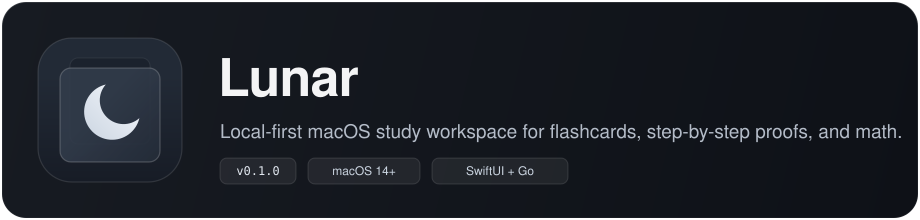
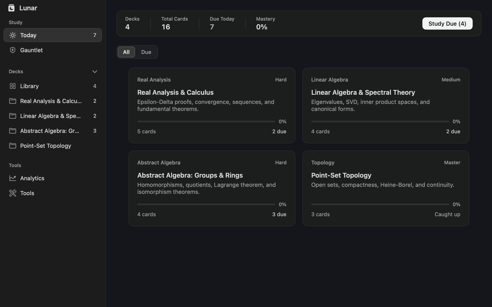
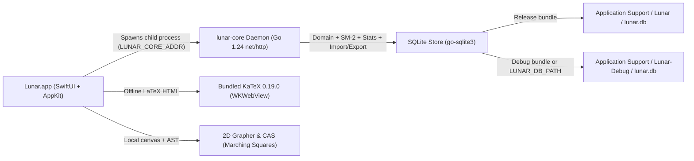

<p align="center">
  
</p>

Lunar is a native macOS study workspace built around one quiet routine: keep your decks on your own Mac, review what is due today, reveal difficult proofs one step at a time, and switch directly to a focus timer or 2D grapher without leaving your desk.

---

## Core Features

### Today & Guided Spaced Repetition
- **Daily Focus Queue:** Opens straight to decks with cards due today, total mastery progress, and crash-safe session recovery.
- **Step-by-Step Proof Reveal:** Cards can split long derivations into progressive layers so you test recall before peeking at the next step.
- **SM-2 Scheduling:** Four recall ratings (`Again`, `Hard`, `Good`, `Easy`) compute upcoming intervals and ease factors locally.

<p align="center">
  
</p>

### Decks, Chapters & Card Organization
- **Structured Chapters:** Group cards under chapters inside each deck, filter by type (`Definition`, `Theorem`, `Example`), difficulty, `Due only`, or search inside the deck (`Search cards`).
- **Offline Math Rendering:** TeX/LaTeX notation inside prompts, hints, and explanations renders locally through bundled KaTeX assets with zero network calls.
- **Bulk & Drag Management:** Reorder cards inside chapters, move selected cards across chapters or decks, and import/export via JSON, Markdown, or delimited text files.

<p align="center">
  
</p>

### Library & Custom Ordering
- **Deck Library:** Create, rename, filter by subject category, or sort decks by custom order, title, due count, card count, or mastery.
- **Live Grid Reordering:** In `Custom Order`, drag deck cards directly across the library grid to set your own study sequence.

<p align="center">
  
</p>

### Gauntlet, Analytics, Focus Timer & 2D Grapher
- **Gauntlet Mode:** Practice mixed runs across multiple decks with configurable length, optional lives limit, and streak tracking without altering SM-2 intervals.
- **Analytics:** Inspect 7/30/90-day review activity alongside a Card Inspector filtered by `All`, `Due`, or `Low Ease`.
- **Focus Timer:** Adjustable Focus, Short Break, and Long Break intervals with a subtle ring countdown and optional menu-bar timer.
- **2D Grapher & CAS Console:** Plot explicit (`y = ...`) and implicit (`x^2 + y^2 = 9`) curves using Marching Squares contour extraction, numbered axes, scroll-wheel zoom, and an inline symbolic CAS (`diff`, `integrate`, `solve`, arithmetic).

<p align="center">
  
</p>

---

## Architecture & Tech Stack

Lunar runs as a two-process local desktop architecture. The SwiftUI application launches `lunar-core` as an auxiliary child process over an ephemeral localhost port (`127.0.0.1:0`), receives `LUNAR_CORE_ADDR=...` over stdout, communicates over JSON REST endpoints, and terminates the child daemon automatically on quit.



### Technology Stack

| Layer | Technology | Role |
| :--- | :--- | :--- |
| **Desktop UI** | Swift 6, SwiftUI, AppKit (`macOS 14+`) | Window shell, monochrome glass theme, custom draggable switch/segmented controls, menu-bar status item |
| **Charts & Math UI** | Swift Charts, WebKit (`WKWebView`), `KaTeX 0.19.0` | Study activity charts and offline LaTeX rendering with bundled `.woff2` fonts |
| **Math & CAS** | Custom Swift parser, AST evaluator, Marching Squares | Implicit/explicit 2D curve plotting, symbolic differentiation, numerical integration, root finding |
| **Core Daemon** | Go 1.24, standard `net/http` `ServeMux` | Local REST API (`/api/decks`, `/api/cards`, `/api/sessions`, `/api/stats`, `/api/import`, `/health`) |
| **Persistence** | SQLite via `github.com/mattn/go-sqlite3` | Local-first deck, card, review history, active session recovery, and preferences storage |
| **Packaging** | Shell scripts, `iconutil`, `codesign`, `ditto` | Separate debug and signed release `.app` / `.zip` macOS bundles |

---

## Testing & Building from Source

### Prerequisites
- macOS 14+ with Xcode Command Line Tools (Swift 6)
- Go 1.24+

### Run Automated Tests

```bash
# Go backend (SM-2, validation, import/export, stats, HTTP API, SQLite store)
cd core && go test ./...

# Swift app (domain models, view models, LaTeX parser, CAS, grapher, Pomodoro)
cd ../LunarApp && swift test
```

### Debug vs. Release Builds

Lunar separates local development/agent builds from shippable release bundles:

| Mode | Command | Bundle Output | Bundle ID | SQLite Store |
| :--- | :--- | :--- | :--- | :--- |
| **Debug** | `./scripts/build_debug.sh` | `build/debug/Lunar Debug.app` | `com.lunar.macos.debug` | `~/Library/Application Support/Lunar-Debug/lunar.db` (or `LUNAR_DB_PATH`) |
| **Release** | `./scripts/build_release.sh --zip` | `build/release/Lunar.app` + `.zip` | `com.lunar.macos` | `~/Library/Application Support/Lunar/lunar.db` |

Override release metadata when packaging externally or in CI:

```bash
APP_VERSION=0.1.0 CODESIGN_IDENTITY="Developer ID Application: ..." ./scripts/build_release.sh --zip
```

### Continuous Integration & GitHub Releases

[`.github/workflows/release.yml`](.github/workflows/release.yml) runs on `macos-15` on every push and pull request to `main`:
1. Executes `go test -v ./...` and `swift test`.
2. Builds `build/release/Lunar-<version>-macos.zip` and its `.sha256` checksum.
3. Uploads the packaged release artifact for every commit pushed to `main`.
4. Publishes a GitHub Release automatically whenever a version tag (`v*`, such as `v0.1.0`) is pushed.
