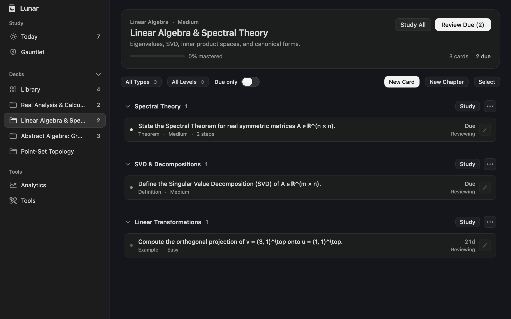
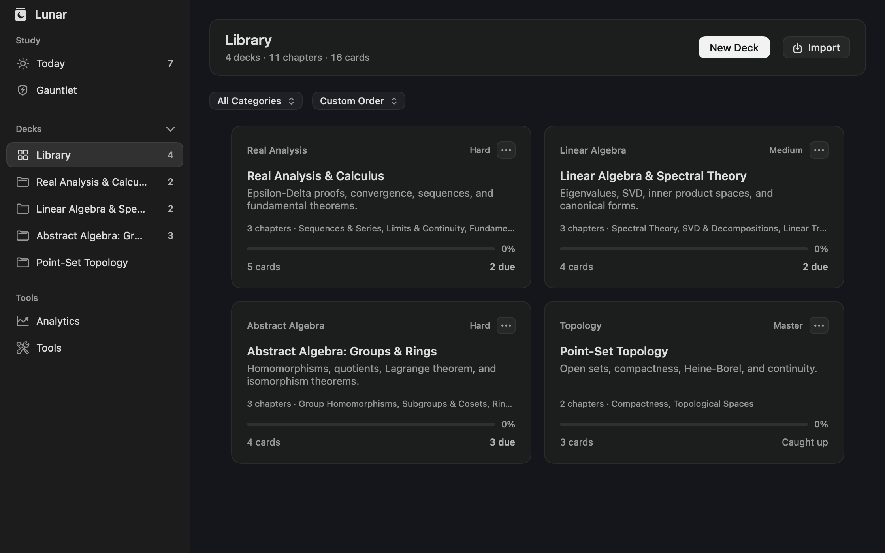
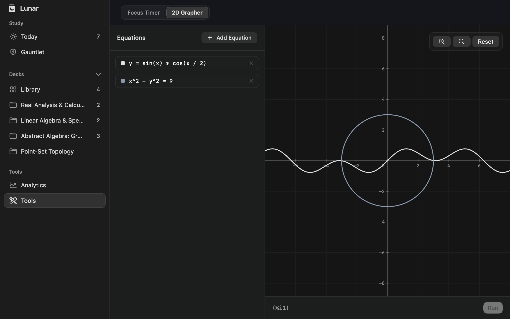
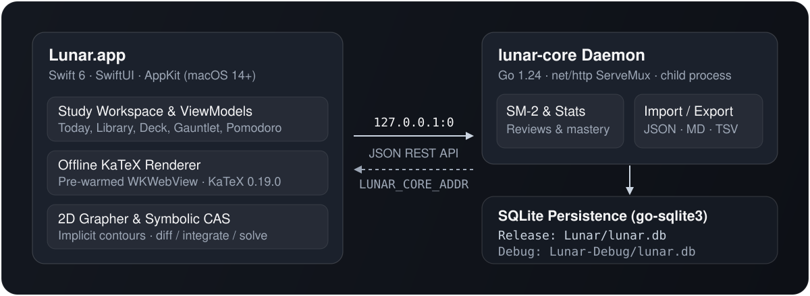

<p align="center">
  <a href="#readme">
    
  </a>
</p>

Lunar is a macOS-first workspace for studying with flashcards and math. Organize your decks on your Mac, review due cards with spaced repetition, add progressive hints to proofs, and use the built-in 2D grapher and focus timer in one place.

---

## Inside Lunar

<p align="center">
  
</p>

- **Hint Layers:** Break long problems or proofs into ordered hints so you can check each step before flipping the card.
- **Daily Review (`Today` & `SM-2`):** Tracks what is due today, restores interrupted sessions on relaunch, and schedules reviews (`Again`, `Hard`, `Good`, `Easy`) locally.
- **Chapters, Filters & Drag Order:** Group cards into chapters, filter by `Definition`, `Theorem`, `Example`, difficulty, or `Due only`, and drag decks or cards in `Custom Order`.
- **Gauntlet & Analytics:** Practice mixed drills across decks without altering SM-2 intervals, and review weak cards under `Low Ease` and 7/30/90-day charts.
- **2D Grapher, CAS & Focus Timer:** Plot explicit and implicit equations (`y = sin(x) * cos(x / 2)`, `x^2 + y^2 = 9`) with numbered axes and scroll-wheel zoom, run `diff` / `integrate` / `solve`, and toggle a menu-bar Pomodoro timer.

<details>
<summary>More views: Today hub, Library grid, and 2D Grapher</summary>

<p align="center">
  
</p>

<p align="center">
  
</p>

<p align="center">
  
</p>

</details>

---

## Install & First Run

### Option 1 — Download `v0.1.0`

Grab `Lunar-0.1.0-macos.zip` from [GitHub Releases](https://github.com/ySimoz/lunar/releases/tag/v0.1.0), unzip it, and move `Lunar.app` to Applications.

> [!NOTE]
> Release bundles are currently ad-hoc signed. On first launch, right-click `Lunar.app` -> **Open** (or clear quarantine if macOS prompts for an unidentified developer).

### Option 2 — Build & Test from Source

Requires **macOS 14+**, **Xcode Command Line Tools (Swift 6)**, and **Go 1.24+**.

```bash
git clone https://github.com/ySimoz/lunar.git
cd lunar

# Build an isolated debug bundle (uses ~/Library/Application Support/Lunar-Debug/lunar.db)
./scripts/build_debug.sh
open "build/debug/Lunar Debug.app"

# Or build a shippable release bundle + zip
./scripts/build_release.sh --zip
open build/release/Lunar.app
```

Run both test suites locally:

```bash
cd core && go test ./...
cd ../LunarApp && swift test
```

---

## Architecture & Tech Stack

Lunar splits UI and persistence across two local processes. When `Lunar.app` launches, it spawns `lunar-core` as an auxiliary child binary bound to an ephemeral localhost port (`127.0.0.1:0`), reads `LUNAR_CORE_ADDR` from stdout, communicates over JSON REST endpoints, and terminates the child daemon cleanly on quit.

<p align="center">
  <a href="#architecture--tech-stack">
    
  </a>
</p>

| Layer | Technology | Responsibility |
| :--- | :--- | :--- |
| **Desktop Shell** | Swift 6, SwiftUI, AppKit (`macOS 14+`) | Window shell, monochrome glass controls, menu-bar Pomodoro item |
| **Charts & LaTeX** | Swift Charts, `WKWebView`, `KaTeX 0.19.0` | Activity charts and offline math rendering using bundled `.woff2` fonts |
| **Math & CAS** | Custom Swift parser, AST, Marching Squares | Explicit/implicit curve plotting, symbolic differentiation, numerical integration, root finding |
| **Core Daemon** | Go 1.24, `net/http` `ServeMux` | Local REST API (`/api/decks`, `/api/cards`, `/api/sessions`, `/api/stats`, `/api/import`) |
| **Storage** | SQLite via `github.com/mattn/go-sqlite3` | Local-first decks, cards, review history, crash recovery, and preferences |

### Debug vs. Release Isolation & CI

| Mode | Script | Output | Bundle ID | SQLite Path |
| :--- | :--- | :--- | :--- | :--- |
| **Debug** | `./scripts/build_debug.sh` | `build/debug/Lunar Debug.app` | `com.lunar.macos.debug` | `~/Library/Application Support/Lunar-Debug/lunar.db` |
| **Release** | `./scripts/build_release.sh --zip` | `build/release/Lunar.app` + `.zip` | `com.lunar.macos` | `~/Library/Application Support/Lunar/lunar.db` |

[`.github/workflows/release.yml`](.github/workflows/release.yml) runs `go test -v ./...` and `swift test` on `macos-15` on every push and pull request to `main`, uploads `Lunar-<version>-macos.zip` + `.sha256` on every `main` push, and publishes a GitHub Release automatically on `v*` tags.
